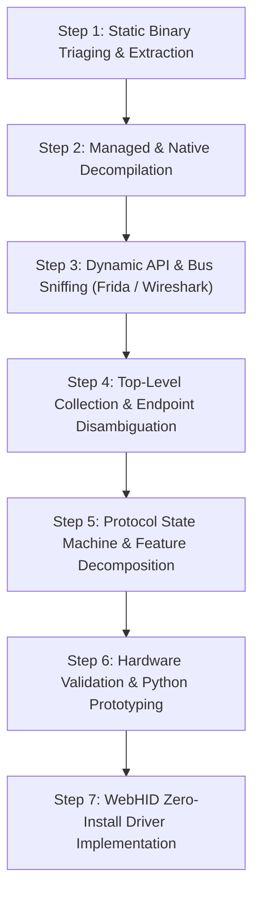

# Reverse Engineering Logitech Onboard Memory Manager (OMM)
**Comprehensive Architectural Analysis & Protocol Engineering Specification**

---

## 1. Executive Summary

Logitech's **Onboard Memory Manager (OMM)** (`OnboardMemoryManager_2.7.4428.exe`, ~13.1 MB) is a dedicated, zero-telemetry utility designed for configuring esports peripherals without background daemon dependencies like G HUB. It operates entirely against the peripheral's internal non-volatile flash memory (EEPROM) and runtime hardware registers using the **Logitech HID++ 2.0 / 4.x** protocol over USB.

This report details the complete reverse engineering of OMM, dissecting its software architecture, transport routing, protocol semantics, memory layouts, and button localization systems. It concludes with an authoritative, step-by-step procedure for reverse engineering similar hardware utilities.

---

## 2. Target Software Architecture & Component Inventory

### 2.1 Binary Packaging & Assembly Extraction
- **Host Binary**: Single-file x64 Windows PE executable targeting **.NET Framework 4.8** with a WPF (Windows Presentation Foundation) user interface.
- **Embedded Resource Bundle**: OMM bundles all core dependencies inside embedded resource streams under `OnboardMemoryManager.embeddeddlls.*`:
  - `MahApps.Metro.dll`, `ControlzEx.dll`: WPF UI styling.
  - Runtime C++ DLLs: `vcruntime140.dll`, `msvcp140.dll`, `ucrtbase.dll`.
  - Core Driver Subsystem: **`logi_nethidppio.dll`** (3.88 MB).
- **Core Driver Engine (`logi_nethidppio.dll`)**:
  - A mixed-mode C++/CLI assembly that bridges managed .NET classes with native Win32 HID APIs (`CreateFileW`, `ReadFile`, `WriteFile`, `GetOverlappedResult`).
  - Contains native classes for each HID++ feature: `logi::hidppio::feature_0000`, `feature_2201`, `feature_8061`, `feature_8070`, `feature_8100`, `feature_8110`.

---

## 3. Step-by-Step Procedure to Reverse Engineer OMM

The following workflow provides the complete, reproducible blueprint used to deconstruct OMM:



### Phase 1: Static Triaging and Extraction
1. **Analyze Binary Headers**:
   - Inspect the PE header using `pefile` or `dumpbin` to verify target architecture (`x64`), subsystem (`GUI`), and CLR runtime version (`v4.0.30319`).
2. **Extract Embedded Resources**:
   - Enumerate manifest resource names. OMM packs DLLs as compressed or raw byte streams.
   - Dump embedded dependencies (specifically `logi_nethidppio.dll`) using `dnfile` or `ILSpy`.
3. **Managed Code Decompilation**:
   - Run `ilspycmd` across the extracted assemblies:
     ```powershell
     ilspycmd -p -o ./logs/dotnet_dump OnboardMemoryManager_2.7.4428.exe
     ilspycmd -p -o ./logs/dotnet_dump/logi_nethidppio logi_nethidppio.dll
     ```
   - This recovers full C# source code for view models, controllers, and protocol feature classes.

### Phase 2: Dynamic API & Wire Interception
1. **Hook Win32 HID Subsystem**:
   - Attach a Frida instrumentation hook to `OnboardMemoryManager.exe` targeting `kernel32.dll` and `hid.dll`:
     - `CreateFileW`: Intercepts device paths, GUIDs, and file access sharing flags (`GENERIC_READ | GENERIC_WRITE`, `FILE_SHARE_READ | FILE_SHARE_WRITE`).
     - `WriteFile`: Captures outgoing HID output reports (direction Host $\to$ Device).
     - `ReadFile` / `GetOverlappedResult`: Captures incoming HID input reports (direction Device $\to$ Host).
2. **Raw Bus Sniffing**:
   - Capture USB packets using Wireshark with USBPcap filter `usb.bus_id and usb.device_address` to capture physical packets without OS driver modification.
3. **Correlate UI Actions with Captured Frames**:
   - Execute single user actions (e.g., change DPI to 1600, toggle profile slot 2, press mouse switch 4, pulse LED).
   - Log exact timestamps to match GUI triggers with exact 7-byte or 20-byte wire frames.

### Phase 3: Hardware Routing & Collection Disambiguation
1. **Enumerate Composite USB Top-Level Collections (TLCs)**:
   - Modern gaming mice register composite interfaces with vendor-specific Usage Pages (`0xFF00`).
   - Query collection usage endpoints:
     - `UsagePage: 0xFF00`, `Usage: 0x0001` (Collection 4)
     - `UsagePage: 0xFF00`, `Usage: 0x0002` (Collection 5)
2. **Identify Channel Split**:
   - Observe that sending a packet to Collection 5 times out, while reading from Collection 4 yields zero bytes.
   - **Crucial Rule**: In Logitech G-series firmware, **Output commands must be addressed to Collection 1 (`Usage 0x0001`)**, while **Input responses and asynchronous interrupts arrive on Collection 2 (`Usage 0x0002`)**.

### Phase 4: Protocol Decoding & Feature Resolution
1. **Decode Framing Headers**:
   - Short Report (`0x10`): 7 bytes total.
   - Long Report (`0x11`): 20 bytes total.
   - Very Long Report (`0x12`): 64 bytes total.
2. **Reverse Feature Discovery (`0x0000` IRoot)**:
   - Identify that feature numbers (e.g., `0x2201`, `0x8100`, `0x8110`) do not map to fixed byte positions on firmware; they are dynamically queried through Feature `0x0000`:
     $$\text{Request: } [0x10, 0xFF, 0x00, 0x01, \text{FeatID}_{hi}, \text{FeatID}_{lo}, 0x00]$$
     $$\text{Reply: } [0x11, 0xFF, 0x00, 0x01, \text{RuntimeIndex}, \text{Type}, \text{Version}, 0x00, \dots]$$
3. **Reconstruct Non-Volatile Flash Transactions (`0x8100`)**:
   - Trace the 16-chunk sequenced packet transfer used to read and write 256-byte EEPROM memory sectors.
   - Decompile `logi::hidppio::Feature8100::writeProfileData` to recover chunk sizing, sector IDs, and trailing 16-bit CRC checksum validation.
4. **Reconstruct Runtime Switch Spy (`0x8110`)**:
   - Isolate `StartSpy` (`Fn 0x01`) and `StopSpy` (`Fn 0x02`).
   - Decouple command responses (`Fn 0x03`, `Fn 0x04`) from asynchronous button transition broadcasts (`Fn 0x00, Sw 0x00`).

### Phase 5: Zero-Install Reproduction (WebHID)
1. **Bridge to Browser API**:
   - Port the packet builder and receiver loop into Javascript using `navigator.hid`.
   - Implement dual collection matching (`col.usagePage === 0xFF00 && (col.usage === 1 || col.usage === 2)`).
   - Enforce single-instance event debouncing and edge-detection filters.

---

## 4. Key Protocol Discoveries & Specifications

### 4.1 Logitech HID++ 2.0 Packet Framing

```
Short Report (0x10, 7 Bytes):
+------+---------+---------+---------+--------+--------+--------+
| 0x10 | DevIdx  | FeatIdx | Fn/SwID | Param0 | Param1 | Param2 |
+------+---------+---------+---------+--------+--------+--------+

Long Report (0x11, 20 Bytes):
+------+---------+---------+---------+--------+--------+--------+-----+---------+
| 0x11 | DevIdx  | FeatIdx | Fn/SwID | Param0 | Param1 | Param2 | ... | Param15 |
+------+---------+---------+---------+--------+--------+--------+-----+---------+
```

- **Byte 0 (Report ID)**: `0x10` (Short, 7 B) or `0x11` (Long, 20 B).
- **Byte 1 (Device Index)**: `0xFF` for direct USB wired; `0x01`..`0x06` for Lightspeed dongle slots.
- **Byte 2 (Feature Index)**: Dynamically resolved runtime index table offset.
- **Byte 3 (Function & Software ID)**:
  - High nibble (`bits 7..4`): Function ID within feature.
  - Low nibble (`bits 3..0`): Software correlation token.

---

### 4.2 Feature `0x8100`: Onboard Profile Memory (EEPROM Layout)

Profiles on Logitech G mice (like G502 HERO) are stored in discrete 256-byte sectors.

#### Sector Writing Sequence
```
Host                                                         Device
  |                                                            |
  |--- TX [10 ff 0c 6f 00 sector 00 ...] (Fn 0x6: Prepare) --->|
  |<-- RX [11 ff 0c 6f 00 00 00 00 ...] (Ack Prepare) ---------|
  |                                                            |
  |--- TX [11 ff 0c 7f <Chunk 1 (16 bytes)>] (Fn 0x7) -------->|
  |<-- RX [11 ff 0c 7f 00 01 00 00 ...] (Ack Chunk 1) ---------|
  |                            ...                             |
  |--- TX [11 ff 0c 7f <Chunk 16 (16 bytes + CRC)>] ---------->|
  |<-- RX [11 ff 0c 7f 00 10 00 00 ...] (Ack Chunk 16) --------|
  |                                                            |
  |--- TX [10 ff 0c 8f 00 00 00] (Fn 0x8: Finalize Write) ---->|
  |<-- RX [11 ff 0c 8f 00 00 00 00 ...] (Ack Finalize) --------|
  |                                                            |
  |--- TX [10 ff 0c 3f 00 sector 00] (Fn 0x3: Activate) ------>|
  |<-- RX [11 ff 0c 3f 00 00 00 00 ...] (Ack Activation) ------|
  |                                                            |
  |--- TX [10 ff 0c cf sector 00 00] (Fn 0xC: Flash Commit) ->|
  |<-- RX [11 ff 0c cf 00 00 00 00 ...] (Flash Save OK) -------|
```

#### Sector Chunk Memory Map (256 Bytes)
| Offset | Content Description |
| :--- | :--- |
| `0x00 - 0x0F` (Chunk 1) | Header: Active DPI index, enabled DPI count, 5x 16-bit little-endian DPI steps |
| `0x10 - 0x4F` (Chunks 2–5) | Button Binding Descriptors (4 bytes per physical switch: Behavior, Action, Modifier, Key) |
| `0x50 - 0xCF` (Chunks 6–13) | Extended G-Shift bindings, Macro blocks, and RGB lighting configurations |
| `0xD0 - 0xEF` (Chunks 14–15) | Polling rate parameters, sensor angle snapping, lift-off distance (LOD) |
| `0xF0 - 0xFF` (Chunk 16) | Padding bytes and 16-bit CRC checksum at bytes 14..15 (`0x3A43`) |

---

### 4.3 Feature `0x8110`: Button Spy & Hardware Switch Localization

Feature `0x8110` (`ButtonSpyRemap`) allows the host to snoop raw physical switch states.

#### Broadcast Report Structure
When active, switch state changes transmit an asynchronous interrupt report:
```
Byte 0: Report ID (0x10 or 0x11)
Byte 1: Device Index (0xFF)
Byte 2: Feature Index for 0x8110
Byte 3: 0x00 (Fn 0x00, Sw 0x00)
Byte 4: Button State Low Byte (Switches 1 to 8 bitmask)
Byte 5: Button State High Byte (Switches 9 to 16 bitmask)
```

$$\text{rawStatus} = (\text{Byte}_5 \ll 8) \mid \text{Byte}_4$$

#### Edge Detection & Single-Instance Resolution
To avoid switch chatter and false triggers:
1. **Rising-Edge Filtering**:
   $$\text{newlyPressedMask} = \text{rawStatus} \ \& \ (\sim\text{lastRawStatus})$$
   A button event is only acknowledged if its bit transitions from `0` to `1`.
2. **Initial Click Exclusion Mask**:
   When the user clicks the "Identify Button" UI button, their physical Primary Button (Left Click) is held down. The engine masks out this button:
   $$\text{eligiblePresses} = \text{newlyPressedMask} \ \& \ (\sim\text{identifyIgnoreMask})$$
3. **One-Shot Auto-Deactivation**:
   As soon as an eligible button is identified, the system immediately:
   - Focuses and highlights the switch in the UI.
   - Clears the identify state (`isIdentifyMode = false`).
   - Terminates the spy loop if it was only spun up on-demand.

---

## 5. Multi-Browser WebHID Concurrency & Flashing Hazards

> [!WARNING]
> Running multiple browser instances (e.g. Chrome, Edge, Brave, Opera) or multiple tabs connected to the same WebHID device simultaneously **severely compromises device communication and will corrupt EEPROM flash writes**.

### Why Concurrent WebHID Instances Cause Failures:
1. **Shared OS Handles vs Half-Duplex Firmware**:
   Under Windows, WebHID uses `CreateFileW` with `FILE_SHARE_READ | FILE_SHARE_WRITE`. Both browsers acquire read/write handles. However, the mouse firmware's USB controller is strictly **half-duplex and stateful**.
2. **Software ID & Sequence Collisions**:
   HID++ uses a 4-bit Software ID (`swId`, `0x0`–`0xF`) to match asynchronous replies with outgoing commands. If Browser A and Browser B dispatch commands simultaneously, their sequence IDs collide. Browser A will consume replies intended for Browser B, triggering request timeouts.
3. **Flash Chunk Interleaving (`0x8100` Corruption)**:
   Flashing an onboard profile requires a strict sequential transaction of **16 contiguous 16-byte chunks (Fn `0x7`) followed by Finalize (Fn `0x8`) and Flash Commit (Fn `0xC`)**.
   - If Browser B sends a routine DPI poll, battery check, or LED update while Browser A is transmitting Chunk 6, the device firmware's internal chunk write buffer is invalidated or reset.
   - When Browser A reaches Chunk 16, the firmware's CRC check fails, rejecting the write.
   - In severe cases, an interleaved commit command can persist incomplete sector chunks, corrupting the onboard profile.
4. **Hardware State Desynchronization**:
   Any profile or lighting alteration made in one browser is not automatically mirrored in the second browser, leading to stale cache reads and accidental rollbacks.

**Best Practice Rule**: Ensure only **one** browser tab holds an active WebHID connection to the peripheral during configuration and flashing operations.

---

## 6. Summary of WebHID Application Fixes Applied

In accordance with this analysis, `webhid-spa` was updated:
1. **`hidpp.js` Broadcast Isolation**:
   Updated the Feature `0x8110` parser to check `featId === 0x8110 && fnId === 0x00 && swId === 0x00`. Responses to `getButtonRemappings()` (`fnId = 0x03`) are no longer misidentified as live button press broadcasts.
2. **`app.js` One-Shot Identification Loop**:
   - Implemented `stopIdentifyMode()` to cleanly turn off Identify Mode immediately after a button is localized.
   - Implemented rising-edge detection (`newlyPressedMask = rawStatus & ~lastRawStatus`) to eliminate duplicate events and chatter.
   - Added `identifyIgnoreMask` to ignore the initial left-click used to activate the Identify button in the UI.
   - Auto-stops live button spy when identify mode concludes if spy was started on-demand.
